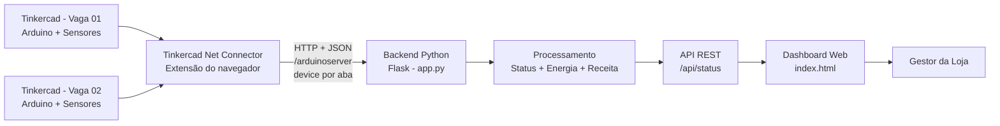
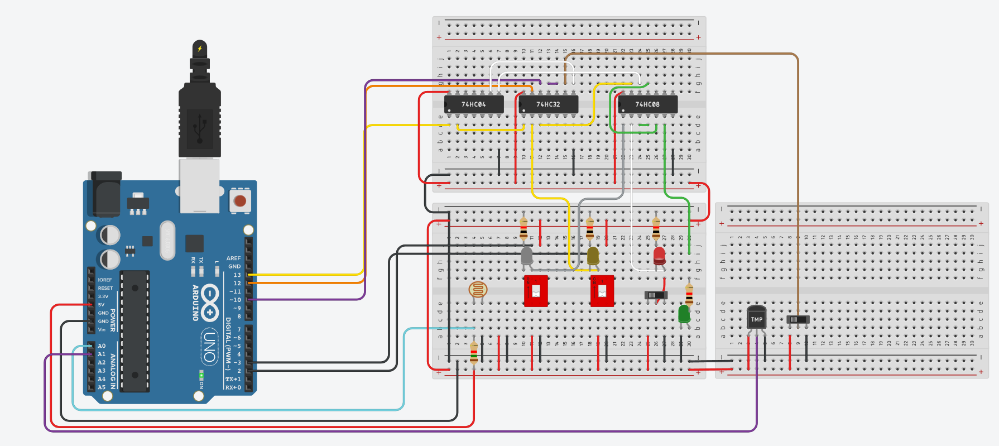
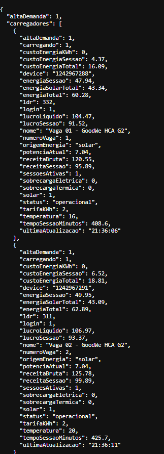
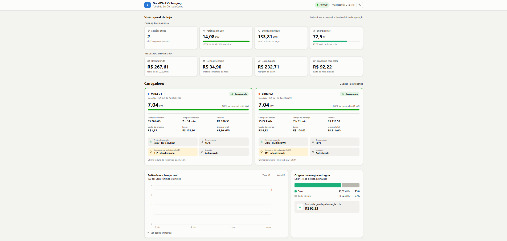
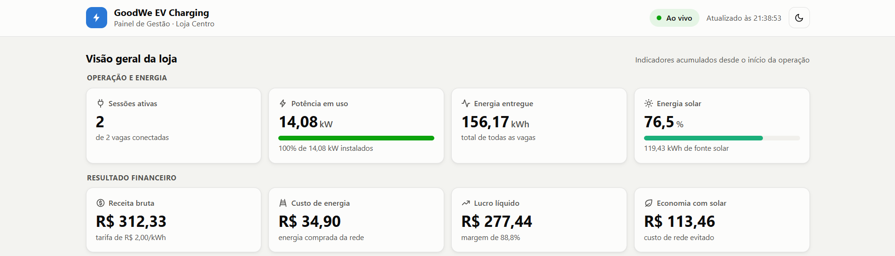
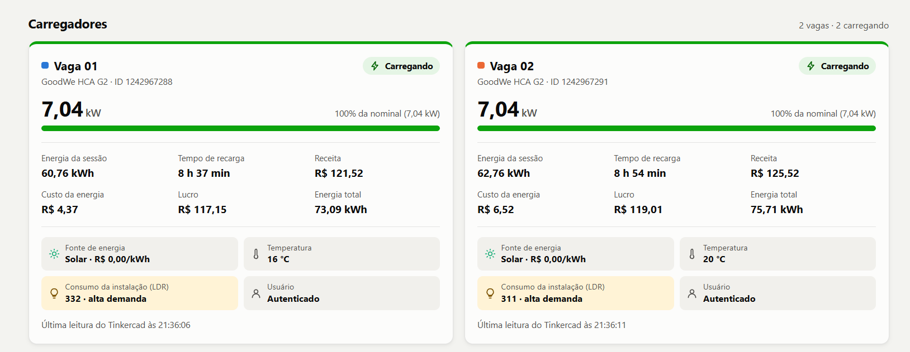
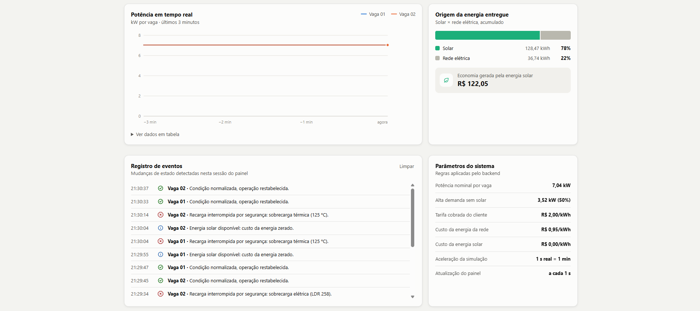
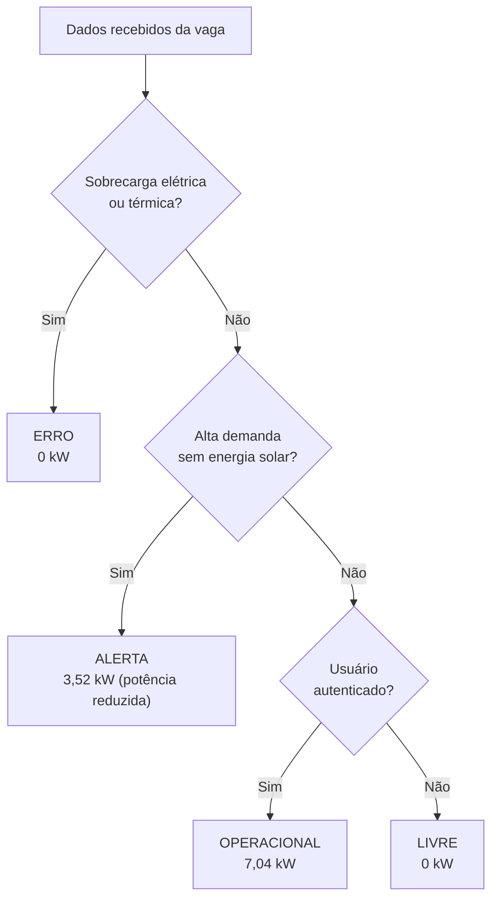

# GoodWe EV Challenge — Sprint
## Prototipagem Funcional e Integração

### Equipe
- Gustavo Pola Simões - RM 570114
- Pedro Henrique Lemgruber - RM 572094
- Gabriel Carlos Barbosa - RM 574074
- Enzo Coppa Selingarde - RM 573393


## 1. Visão geral

Este projeto apresenta um protótipo funcional e simulado para monitoramento de carregadores de veículos elétricos GoodWe em um estabelecimento comercial.

A solução integra dois circuitos simulados no Tinkercad, um backend em Python com Flask e um dashboard web em HTML, permitindo acompanhar em tempo real o estado individual de cada carregador e os indicadores consolidados da loja.

O sistema demonstra:
- autenticação simulada do usuário;
- disponibilidade de energia solar;
- leitura do sensor LDR;
- leitura de temperatura;
- identificação de alta demanda;
- identificação de sobrecarga elétrica e térmica;
- status individual de cada carregador;
- potência atual;
- energia consumida por sessão;
- tempo de sessão;
- receita da sessão;
- energia total da loja;
- receita bruta acumulada;
- quantidade de sessões ativas;
- redução automática da potência em alta demanda sem energia solar;
- custo da energia conforme a origem (solar ou rede), lucro líquido e percentual de energia solar.

## 2. Arquitetura da solução



### Fluxo de integração

1. Cada circuito no Tinkercad executa o mesmo código Arduino.
2. O Arduino envia seus dados pelo Monitor Serial em formato JSON.
3. A extensão do navegador captura o JSON e envia os dados ao Flask.
4. Cada aba do Tinkercad possui um `device` diferente, permitindo que o backend identifique cada carregador separadamente.
5. O backend processa o status, simula consumo de energia e calcula receita.
6. A rota `/api/status` disponibiliza os dados consolidados.
7. O dashboard consulta a API periodicamente e cria um card para cada carregador.

## 3. Componentes utilizados

### Simulação / hardware
- Arduino no Tinkercad;
- sensor de luminosidade LDR;
- sensor de temperatura;
- chaves para autenticação/login e energia solar;
- LEDs/saídas para indicação de alta demanda e sobrecargas;
- buzzer para alertas.



*Circuito de um carregador no Tinkercad. O mesmo circuito e o mesmo código Arduino são usados nas duas vagas.*

### Software
- Tinkercad Circuits;
- Arduino/C++;
- Python;
- Flask;
- JSON;
- HTML, CSS e JavaScript;
- extensão de navegador **Tinkercad Net Connector**, adaptada do projeto open source TinkercadNetConnector (ver [Créditos](#13-créditos)).

## 4. Justificativa técnica

O Tinkercad foi escolhido por permitir a criação e demonstração do circuito de forma simulada, sem depender de hardware físico.

O Arduino representa a camada responsável pela leitura dos sensores e pela automação local. Ele identifica condições como alta demanda e sobrecargas e disponibiliza os dados por meio do Monitor Serial.

O formato JSON foi adotado para estruturar a comunicação entre o circuito e o backend, pois é simples de interpretar tanto em Python quanto em JavaScript.

O Flask foi utilizado como backend por permitir a criação de um servidor e de uma API REST de forma simples e adequada ao protótipo.

O dashboard em HTML, CSS e JavaScript permite que o gestor visualize em um único painel vários carregadores, seus estados e indicadores de consumo e receita.

A identificação por `device` permite que vários circuitos utilizem o mesmo backend sem sobrescrever os dados uns dos outros.

## 5. Regras de funcionamento

Cada carregador possui potência simulada de **7,04 kW**.

A tarifa utilizada no protótipo é de **R$ 2,00 por kWh**.

Para facilitar a demonstração em vídeo, a simulação utiliza aceleração de tempo:

**1 segundo real = 1 minuto de recarga simulada.**

A energia é calculada por:

`Energia (kWh) = Potência (kW) × Tempo (h)`

A receita é calculada por:

`Receita (R$) = Energia (kWh) × Tarifa (R$/kWh)`

A recarga ocorre quando o usuário está autenticado e o carregador está em condição operacional.

Em caso de sobrecarga elétrica, sobrecarga térmica ou condição de bloqueio, a potência do carregador passa para zero e o acúmulo de energia e receita é interrompido enquanto o problema permanecer.

### Influência da energia solar

A disponibilidade de energia solar altera tanto a **potência** quanto o **custo** da recarga:

| Situação | Potência | Origem da energia | Custo para a loja |
|---|---:|---|---:|
| Com energia solar (demanda normal ou alta) | 7,04 kW | Solar | R$ 0,00/kWh |
| Sem energia solar, demanda normal | 7,04 kW | Rede | R$ 0,95/kWh |
| Sem energia solar, **alta demanda** (alerta) | **3,52 kW** (50%) | Rede | R$ 0,95/kWh |
| Sobrecarga elétrica ou térmica | 0 kW | — | — |

Em alta demanda sem energia solar, o carregador entra em estado de **alerta** e continua a recarga com **potência reduzida**, aliviando a rede elétrica. Com energia solar disponível, a potência total é mantida mesmo em alta demanda.

O custo da energia e o lucro são calculados por:

`Custo (R$) = Energia (kWh) × Custo da energia conforme a origem (R$/kWh)`

`Lucro (R$) = Receita (R$) − Custo (R$)`

A receita bruta representa o valor pago pelo cliente e não depende da origem da energia. O custo da energia e o lucro líquido são apresentados separadamente no dashboard, junto com o percentual da energia entregue que veio da fonte solar.

## 6. Dados funcionais obtidos

Exemplo registrado durante a execução do protótipo com dois carregadores ativos:

| Indicador | Resultado |
|---|---:|
| Carregadores identificados | 2 |
| Sessões ativas | 2 |
| Potência da Vaga 01 | 7,04 kW |
| Potência da Vaga 02 | 7,04 kW |
| Potência total | 14,08 kW |
| Energia da Vaga 01 | 3,39 kWh |
| Energia da Vaga 02 | 2,05 kWh |
| Energia total informada pela API | 5,43 kWh |
| Receita da Vaga 01 | R$ 6,77 |
| Receita da Vaga 02 | R$ 4,09 |
| Receita bruta | R$ 10,86 |

A pequena diferença entre a soma dos valores exibidos por vaga e o total pode ocorrer por arredondamento, pois o backend realiza os cálculos com maior precisão e arredonda apenas os valores enviados para exibição.

### Registros da execução

**Resposta da API `/api/status`** com os dois carregadores identificados individualmente pelo `device` de cada aba do Tinkercad:



### Dashboard do gestor

O dashboard possui tema claro e escuro. As imagens abaixo acompanham o tema configurado no GitHub de quem está visualizando.

**Visão completa** do painel, com os indicadores da loja, os carregadores e os gráficos:

<picture>
  <source media="(prefers-color-scheme: dark)" srcset="docs/dashboard-completo-dark.png">
  
</picture>

**Visão geral da loja:** indicadores de operação (sessões ativas, potência em uso, energia entregue e participação solar) e de resultado financeiro (receita bruta, custo de energia, lucro líquido e economia gerada pelo solar):

<picture>
  <source media="(prefers-color-scheme: dark)" srcset="docs/dashboard-visao-geral-dark.png">
  
</picture>

**Carregadores:** um card por vaga, com status, potência em relação à nominal, dados da sessão (energia, tempo, receita, custo e lucro) e leituras dos sensores (fonte de energia, temperatura, consumo e usuário):

<picture>
  <source media="(prefers-color-scheme: dark)" srcset="docs/dashboard-carregadores-dark.png">
  
</picture>

**Acompanhamento:** gráfico de potência em tempo real por vaga, origem da energia entregue (solar × rede), registro de eventos (sessões, alertas, sobrecargas e normalizações) e parâmetros aplicados pelo backend:

<picture>
  <source media="(prefers-color-scheme: dark)" srcset="docs/dashboard-acompanhamento-dark.png">
  
</picture>

## 7. Energia renovável e automação

A energia solar faz parte da lógica de operação do protótipo.

O sistema monitora a disponibilidade de energia solar e condições de demanda. Quando há energia solar, a recarga utiliza energia gerada no local, sem custo de rede, e mantém a potência total mesmo em alta demanda. Sem suporte solar, a energia vem da rede com custo por kWh e, em alta demanda, o carregador entra em alerta e reduz automaticamente a potência para 50%. A proposta demonstra como uma fonte renovável pode ser considerada na tomada de decisão de uma infraestrutura de recarga, impactando diretamente a operação e o resultado financeiro da loja.

A automação também é aplicada nas regras de segurança: condições de sobrecarga ou temperatura inadequada alteram automaticamente o estado do carregador e interrompem a simulação de consumo.

## 8. Conexão com os conteúdos da disciplina

O protótipo aplica conteúdos relacionados a:
- programação e lógica computacional;
- automação;
- comunicação entre sistemas;
- APIs;
- troca de dados em JSON;
- processamento de dados;
- integração entre hardware simulado e software;
- desenvolvimento web;
- coleta e visualização de indicadores;
- pensamento computacional (ver seção 9).

Nesta Sprint, o funcionamento implementado utiliza regras determinísticas e automação. Caso inteligência artificial seja abordada como evolução futura do projeto, ela deve ser apresentada separadamente do que já está implementado no protótipo atual.

## 9. Pilares do Pensamento Computacional

O desenvolvimento do protótipo aplicou os quatro pilares do Pensamento Computacional: **decomposição**, **reconhecimento de padrões**, **abstração** e **algoritmos**.

### 9.1 Decomposição

O problema "monitorar os carregadores de uma loja" foi dividido em partes menores, cada uma com uma responsabilidade, que puderam ser desenvolvidas e testadas separadamente:

| Parte | Responsabilidade |
|---|---|
| Circuito no Tinkercad (`carregador.ino`) | Ler os sensores, aplicar a automação local e enviar os dados em JSON |
| Extensão do navegador | Levar os dados do Monitor Serial até o backend |
| Backend Flask (`app.py`) | Identificar cada vaga e calcular status, potência, energia, custo e receita |
| API `/api/status` | Disponibilizar os dados processados e consolidados |
| Dashboard (`index.html`) | Exibir os indicadores para o gestor da loja |

A mesma ideia foi aplicada dentro do backend: cada etapa do processamento é uma função com uma única responsabilidade, como `calcular_status`, `atualizar_estado_recarga`, `atualizar_simulacao` e `calcular_resumo`.

### 9.2 Reconhecimento de padrões

- As duas vagas têm o mesmo comportamento, por isso utilizam o **mesmo código Arduino** e o mesmo modelo de dados no backend (`criar_carregador`). Para adicionar uma nova vaga, basta abrir outro circuito, sem alterar o código.
- Todas as mensagens seguem o mesmo formato JSON. Esse padrão permite que a extensão reconheça os dados do carregador no Monitor Serial por meio de uma expressão regular.
- Energia, receita e custo seguem o mesmo padrão de cálculo, uma grandeza multiplicada por uma taxa: `Potência × Tempo`, `Energia × Tarifa` e `Energia × Custo por kWh`.
- As leituras dos sensores são classificadas por faixas que se repetem como regras de decisão: com usuário autenticado, LDR entre 300 e 500 indica alta demanda e LDR até 300 indica sobrecarga elétrica; temperatura a partir de 65 °C ou até −35 °C indica sobrecarga térmica.

### 9.3 Abstração

O protótipo representa apenas os aspectos do problema real que são relevantes para a gestão da recarga:

- O carregador físico é representado por um conjunto de dados (status, potência, energia, custo e receita), sem os demais detalhes do equipamento.
- Componentes simples representam situações reais: as chaves representam a autenticação do usuário e a disponibilidade de energia solar, o LDR representa o nível de consumo da instalação e o sensor de temperatura representa o aquecimento do equipamento.
- O tempo é acelerado (1 segundo real = 1 minuto de recarga) para que uma sessão completa possa ser demonstrada em poucos minutos.
- A API oculta os campos internos de controle (prefixo `_`), e o dashboard mostra ao gestor somente os indicadores úteis para a tomada de decisão.

### 9.4 Algoritmos

O comportamento do sistema é definido por sequências de passos bem definidas:

1. **Arduino**, a cada ciclo do `loop()`: lê os sensores, compara as leituras com os limites, aciona os LEDs de alerta e envia o JSON a cada 1 segundo.
2. **Backend**, a cada mensagem recebida: acumula a energia, o custo e a receita do intervalo anterior, atualiza os dados da vaga e recalcula o status e a potência.
3. **Dashboard**: consulta a API a cada 1 segundo e atualiza os indicadores e os cards.

O algoritmo que define o status e a potência de cada carregador avalia as condições em ordem de prioridade:



As condições de segurança são verificadas primeiro, para que um carregador em sobrecarga nunca forneça energia, independentemente das demais condições.

## 10. Estrutura do repositório

```text
├── app.py                        # Backend Flask: recebe os dados, simula a recarga e expõe a API
├── index.html                    # Dashboard web do gestor da loja
├── carregador.ino                # Código Arduino usado nos dois circuitos do Tinkercad
├── circuitos.txt                 # Links dos circuitos no Tinkercad
├── requirements.txt              # Dependências Python
├── README.md
│
├── connector_tinkercad_python/   # Extensão do Chrome (adaptada do TinkercadNetConnector)
│   ├── manifest.json
│   ├── background.js
│   ├── content.js
│   ├── popup.html / popup.js
│   ├── on.png / off.png
│   ├── LICENSE                   # GPL-3.0, licença do projeto original
│   └── README.md                 # Créditos e modificações realizadas
│
└── docs/                         # Imagens usadas neste README
    ├── circuito.png
    ├── api-status.png
    ├── dashboard-completo-light.png / -dark.png
    ├── dashboard-visao-geral-light.png / -dark.png
    ├── dashboard-carregadores-light.png / -dark.png
    └── dashboard-acompanhamento-light.png / -dark.png
```

## 11. Como executar

### Requisitos
- Python instalado;
- Flask instalado;
- navegador Chrome ou compatível;
- extensão de integração com o Tinkercad carregada;
- circuitos do Tinkercad abertos.

### Instalação

No terminal, dentro da pasta do projeto:

```bash
pip install -r requirements.txt
```

Depois:

```bash
python app.py
```

O servidor será iniciado em:

```text
http://localhost:8080
```

API:

```text
http://localhost:8080/api/status
```

### Extensão do navegador

1. No Chrome, acesse `chrome://extensions/` e ative o **Modo do desenvolvedor**.
2. Clique em **Carregar sem compactação** e selecione a pasta `connector_tinkercad_python`.

Instruções detalhadas e créditos da extensão estão em [`connector_tinkercad_python/README.md`](connector_tinkercad_python/README.md).

### Tinkercad

1. Abra cada circuito em uma aba diferente.
2. Inicie a simulação.
3. Abra o Monitor Serial.
4. Certifique-se de que a extensão esteja configurada para enviar os dados para:

```text
http://127.0.0.1:8080/arduinoserver
```

5. Abra o dashboard no navegador em `http://localhost:8080`.
6. Altere login, energia solar, LDR e temperatura no circuito para observar a atualização do sistema.

## 12. Resultado

O protótipo atingiu a integração entre circuito simulado, backend e interface web.

Com uma única aplicação Flask, o sistema consegue receber dados de múltiplos carregadores, tratá-los individualmente e consolidar indicadores para o gestor da loja.

A solução demonstra um caminho para monitoramento de infraestrutura de recarga de veículos elétricos com automação, segurança operacional, acompanhamento energético e consideração de fontes renováveis.

## 13. Créditos

### Extensão Tinkercad Net Connector

A extensão de navegador utilizada na integração (`connector_tinkercad_python/`) é uma versão adaptada do projeto open source **TinkercadNetConnector**, desenvolvido por **Joshua Ellul** e **Carl James Debono**, da University of Malta.

- Repositório original: <https://github.com/joshuaellul/tinkercad-net-connector>
- Artigo: ELLUL, Joshua; DEBONO, Carl James. TinkercadNetConnector: Connecting emulated IoT devices to the outside world. **SoftwareX**, v. 20, 101218, 2022. DOI: [10.1016/j.softx.2022.101218](https://doi.org/10.1016/j.softx.2022.101218).
- Licença: GNU General Public License v3.0. A versão adaptada mantém a mesma licença ([`connector_tinkercad_python/LICENSE`](connector_tinkercad_python/LICENSE)).

A extensão original transforma a saída serial dos Arduinos simulados no Tinkercad em requisições HTTP. O protocolo de comunicação usado neste projeto (`/arduinoserver?msg=output&out=...&device=...`) e a identificação de cada circuito pelo ID da aba do navegador vêm dessa extensão.
